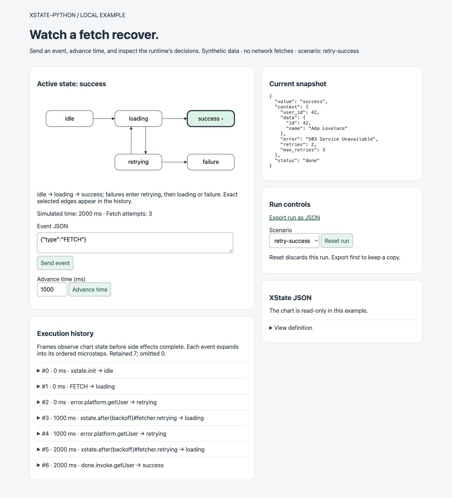

# Local Fetch Inspector

This optional source-checkout example lets you operate the fetch-with-retry chart
and inspect the actual Python actor runtime. It uses only the standard library
for its server and UI; the core library still has no runtime dependencies.

## Fast path

```bash
poetry install
poetry run python docs/examples/local_inspector.py
```

Open the printed `http://127.0.0.1:<port>` URL. Send the prefilled `FETCH` event,
then advance time twice by 1,000 ms. The active state progresses through retrying
to success, with three synthetic fetch attempts. Stop the server with Ctrl-C.
Use `--port 8765` if you need a fixed port.



## Step by step

1. Inspect the XState JSON definition. It is loaded from
   `docs/examples/fetch_with_retry.json`; the browser does not edit the chart.
2. Send an event object. Unknown events are accepted and recorded as ignored by
   the machine. Runtime lifecycle event names are reserved for the runtime.
   Additional payload fields are retained in the command export; this chart's
   FETCH transition does not consume them. User 42 is literal invoke input.
3. Advance simulated time. At 999 ms the backoff has not fired; one more
   millisecond admits the next attempt. Waiting in real time does nothing.
4. Expand history entries to see every microstep, its selected transitions, and
   intermediate snapshot. Repeated event names remain separate observations.
5. Export the run before resetting. Select immediate success, retry-success, or
   exhausted retries. Reset constructs fresh actor, clock, and fetch resources.

The fetch is a synchronous synthetic promise implementation. No network request,
credentials, JavaScript evaluation, or production integration is involved.
The diagram layout supports this example's five flat states. The underlying
traces can represent multiple transitions per microstep; the UI makes no claim
to be a general statechart editor or the Stately inspection wire protocol.

## Reading the evidence

Inspection callbacks observe the committed chart before side effects and actor
reconciliation finish. A `FETCH → loading` frame is therefore followed by an
actor completion/error frame; it does not prove that the fetch succeeded.
The current snapshot is read after the submitted command returns.
`context.error` retains the most recent failure even after eventual success,
matching the original example; `value` and `status` identify the current outcome.

The server owns one session and processes requests serially. Multiple tabs share
that session. Reload is read-only; successful commands redirect to GET so normal
refresh does not repeat a send. Host/Origin checks, a per-process form token,
request size limits, timeouts, and HTML escaping bound the local control surface.
It is a development example, not a server for shared or public deployment.

At most 200 commands are admitted. The newest 200 macrostep frames are retained,
and omitted frame counts and sequence numbers make truncation visible. The
version-1 JSON export includes chart configuration, scenario, commands, simulated
time, attempt count, current snapshot, and retained frames. This is an example
artifact format, not a new public core API. It contains synthetic context and
user-entered event payloads; inspect it before sharing. Reset loses the in-memory
run. There is no disk persistence or import endpoint.

## Reproduce equivalence

```bash
poetry run python -m pytest tests/test_local_inspector.py
poetry run mypy --explicit-package-bases docs/examples/fetch_with_retry.py docs/examples/local_inspector.py
```

Tests create three independent runs per scenario: the inspector, a directly
operated actor with inspection, and a directly operated actor without inspection.
They compare snapshots after each command, attempt counts, and the exact ordered
microstep/transition sequence using an independent trace projection. Explicit
expected states and counts prevent agreement on the same incorrect outcome from
passing. Cases cover immediate success, two failures then success, exhausted
retries and eventless completion, partial time advances, and ignored payload events.
Transport tests exercise form commands, export, reset, invalid input, and request
boundaries; history tests verify truncation and escaping.

These are local reproducible checks. Hosted CI and a published release remain
separate evidence. The implementation plan records the inspected repository and
issue context in [local-inspector.md](../plans/local-inspector.md).
