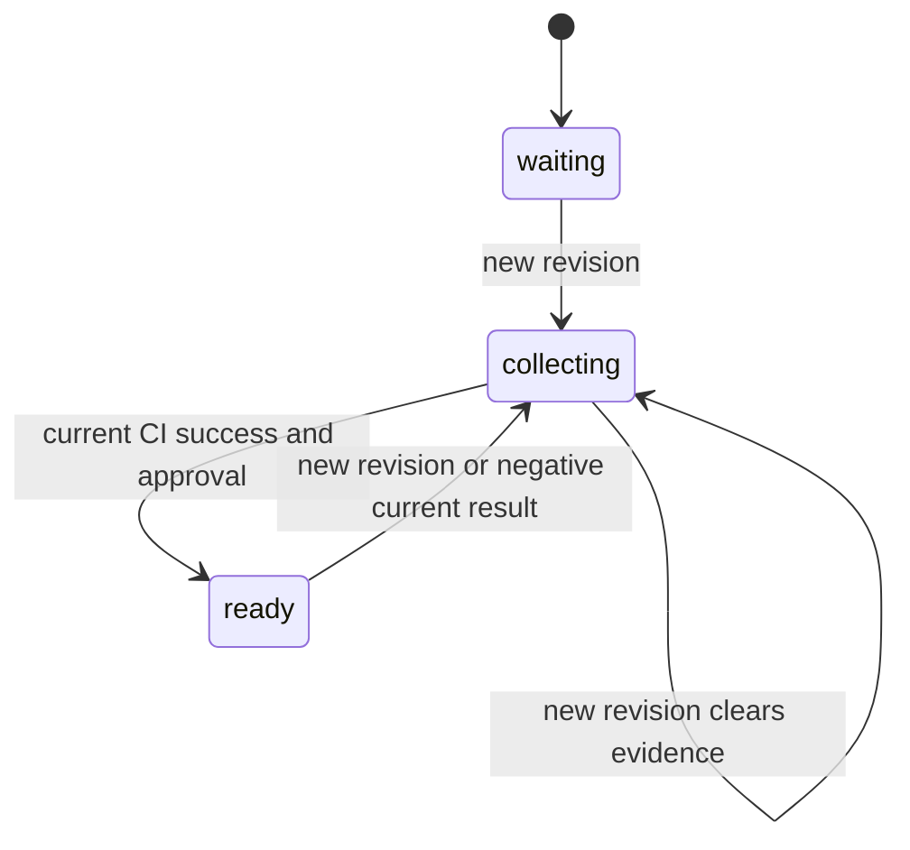

# Keep review evidence attached to the code it describes

A successful CI run and an approval for yesterday's commit do not describe the
new commit you just pushed. This example models that rule with a small statechart:
record the current revision, collect evidence for that revision, and revoke
readiness when either the revision or its recorded evidence changes.

The program runs entirely offline using scripted events and synthetic commit
IDs. It makes no GitHub or model-provider calls. `ready` means the two recorded
conditions are satisfied; it does not authorize or perform a merge.

Files: [Python implementations](../examples/revision_gate.py),
[JSON chart](../examples/revision_gate.json), and
[behavioral tests](../../tests/test_revision_gate_example.py).

## Run it

After the [source installation](../getting-started.md), run from the repository
root using that environment's Python:

```bash
python docs/examples/revision_gate.py
```

Contributors using the locked environment can use
`poetry run python docs/examples/revision_gate.py`. The chart path is resolved
relative to the Python file, so the program also works from another directory
when the library is installed and the script is addressed by its full path.

Expected output:

```text
revision A: ready (head=aaaaaaa, ci=success, review=approved)
revision B: collecting (head=bbbbbbb, ci=missing, review=missing)
stale A results: collecting (head=bbbbbbb, ci=missing, review=missing)
restored B: collecting (head=bbbbbbb, ci=success, review=missing)
review B approved: ready (head=bbbbbbb, ci=success, review=approved)
CI rerun failed: collecting (head=bbbbbbb, ci=failure, review=approved)
CI rerun passed: ready (head=bbbbbbb, ci=success, review=approved)
```

Only the display abbreviates the IDs. Event matching uses the entire string.

## Read the chart



`ready` is an active state, not a final state. The actor must continue accepting
events so a failed rerun or a request for changes can revoke readiness. The
`always` transitions derive readiness after assignments update the context;
Python does not maintain a separate mutable phase flag.

| Event | Accepted when | Context change |
| --- | --- | --- |
| `REVISION` | Its SHA is a nonempty string different from the current head | Replace the head and clear both CI and review evidence |
| `CI_RESULT` | Its SHA equals the current nonempty head and result is `success` or `failure` | Record that SHA and CI result |
| `REVIEW_RESULT` | Its SHA equals the current nonempty head and result is `approved` or `changes_requested` | Record that SHA and review result |

CI and review results for another revision are ignored. A repeated `REVISION`
with the same head preserves evidence. Repeating an identical result leaves the same state
and context; this is idempotence of the recorded data, not a general event
deduplication or delivery guarantee.

## Bind ordinary Python functions

The JSON contains state structure, context data, and implementation names. The
Python factory loads that file unchanged and binds `assign(...)` handlers and
guards through `Machine(..., actions=..., guards=..., strict=True)`.

For example, `is_current_ci` checks the event against the current head, while
`record_ci` supplies the new fields for the assignment. `has_current_evidence`
requires both stored evidence SHAs to equal that head and both outcomes to be
positive. Keeping the evidence identity in context makes a checkpoint readable
without guessing which commit a Boolean referred to.

`TypedDict` event types describe the intended caller contract. They do not
validate events at runtime: the guards separately check the fields this example
needs. Strict machine construction validates the chart configuration; it does
not authenticate an incoming event or verify a Git object.

The same factory works with the pure `Machine.transition(...)` API. The tests
use pure transitions to check the domain rules and a running actor to check
the snapshot handoff. JSON loading alone does not establish JavaScript runtime
parity for this example; consult the existing
[tested compatibility contract](../concepts/xstate-compatibility.md).

## Hand off a snapshot

The demo checkpoints after CI succeeds for revision B, before its approval:

1. Serialize the actor snapshot and round-trip it through `json.dumps`/`loads`.
2. Stop the original actor.
3. Construct a separate machine with the same definition and named bindings.
4. Deserialize the checkpoint and pass it as `create_actor(machine, snapshot=...)`.
5. Start the replacement actor and deliver the remaining recorded events.

The constructor exposes the supplied snapshot before startup and skips fresh
initial computation. The demo's snapshot contains only JSON-compatible data;
there are no invoked children, timers, or external side effects to reconstruct.
Both actors are stopped in `finally` blocks.

This is an in-memory JSON handoff between actor instances in one process. It
does not write a file, perform a database transaction, or test process-crash
recovery. Snapshot serialization does not preserve queued events, remaining
deadlines, child progress, subscriptions, or completed external effects. See
[snapshot persistence](../concepts/persistence.md) before building recovery.

## What a real host must decide

This example deliberately accepts scripted input as trusted. In an application,
the host must establish the repository and pull-request identity, authoritative
head revision, acceptable CI jobs, and reviewer authority before sending events.
An LLM response or a JSON object claiming success is not that evidence.

Results for the **same** SHA are applied in arrival order. There is no CI-run
identity, reviewer identity, attempt counter, timestamp ordering, required-check
aggregation, or dismissal policy. A late success from an old run could replace
a newer failure for the same SHA unless the host rejects it. The host must
normalize those external histories into the current authoritative result for
each gate. Similarly, a delayed `REVISION` event could select an older head;
only the host knows which revision is currently authoritative.

Before a real merge, the host must recheck external state and authorization and
bind its request to the expected head SHA. For crash recovery it must also own
durable event/effect records, atomic persistence, and reconciliation of unknown
tool outcomes. None of those guarantees follows from reaching `ready`.

This example teaches one bounded slice of
[issue #56](https://github.com/JovaniPink/xstate-python/issues/56): revision-bound
evidence and a compatible snapshot handoff. The broader recovery and fake-tool
scenario remains open. It does not demonstrate that a coordinator saves effort,
prove provider integrations, or run the Measured comparison. The
[contribution-workflow observation protocol](../plans/pythonic-agent-workflows-research.md#bounded-observation-of-the-current-pr-series-56)
remains the way to collect that product evidence before expanding the system.
