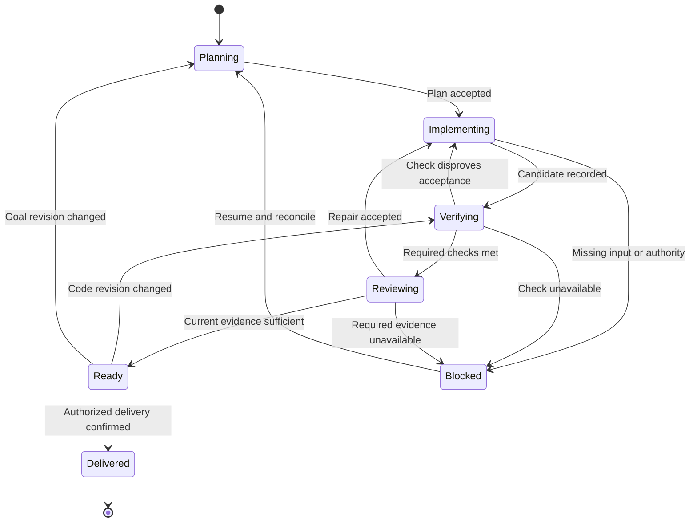
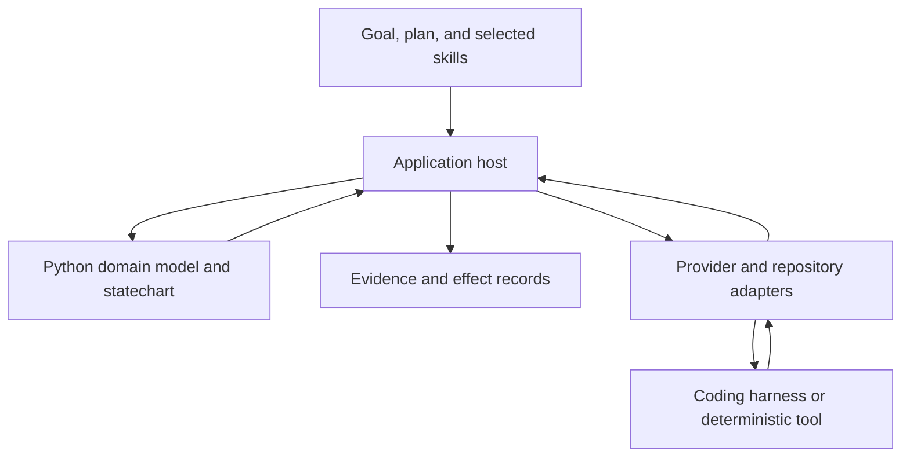

# Pythonic statecharts for agent-assisted software delivery

## Status, decision, and scope

**Research and design proposal, November 20, 2026 (America/New_York).**

The maintainer's direction is **Pythonic first**: make this a useful Python
library in its own right, learn from the Python state-machine ecosystem, and
investigate a specific role in software development with coding agents.
XState JSON remains a supported interoperability boundary. Existing execution
guarantees remain engineering obligations.

The proposed first application is **coordinating a contribution through planning,
implementation, verification, and review, while keeping evidence attached to the
goal and code revision it actually describes**. This application is a hypothesis
to evaluate. A reusable orchestration product, provider adapters, durable host,
and Python authoring facade are not implemented by this document.

This research updates the product priority in the
[November 12 roadmap](statechart-workflow-roadmap.md). Its correctness work and
acceptance cases remain useful; proving a shared JavaScript/Python chart is no
longer the prerequisite for every Python-focused improvement. The
[Google ADK proposal](../integrations/adk-and-agent-skills.md) remains a separate,
unimplemented integration option.

### Implementation status — November 25, 2026

The original research below remains pinned to November 20. Later runtime work
has its own implementation evidence and review status:

| Work | Status | Exact boundary |
|---|---|---|
| Stored completed output | **Merged: [#64][X12]** | `deserialize_snapshot()` preserves stored output, including explicit null, without rerunning its callable; detached copies and legacy fallback are documented on [current master][X13]. |
| Observable factory input (#53) | **Draft: [#66][X14]** | [Candidate implementation][X15] shares the promise input binder and covers positional factories, supported legacy forms, emissions, errors, and cancellation. #53 remains open until the fix merges. |
| Duplicate IDs and `invoke.systemId` | **Draft: [#67][X16]** | [Candidate implementation][X17] rejects duplicate resolved state IDs at construction and classifies `systemId` as unsupported in strict validation. Permissive construction still ignores that alias; it is not implemented. |
| Constructor snapshot initialization (#54) | **Draft: [#68][X18]** | [Candidate implementation][X19] skips fresh initial computation for `create_actor(machine, snapshot=...)`. Standalone interpreters and actors without a constructor snapshot retain eager initialization; normal startup resources and pending actions retain their existing policy. |

The last two slices follow the [gstate research in draft #65][X20]. They do not
complete general structural validation or durable restoration. #54 remains open
for broader restoration work. #56 and #57 remain open, and the Measured
comparison remains `prepared_not_run`; these runtime changes provide no new
application, provider-integration, or adoption evidence.

### Original research evidence — November 20, 2026

| Subject | Inspected baseline | What this establishes |
|---|---|---|
| This repository | [`ed8c331c136bc4f5a872317bb5b88f8d5859a680`][X1] | Source and documentation available before this proposal; no new runtime implementation |
| Measured Skills | [`610bc7ea7c58e11b48d8fcd1eb155a75e5f12069`][M1] | Public source, generated projections, review protocols, and prepared evaluation artifacts |
| yay-machine | [`c2769124087ad30a83b6ea47759b998305ffb49a`][Y1] | A design reference for state-oriented types, concise definitions, and maintained examples |
| Local Codex executable | `codex-cli 0.172.0-alpha.2`; `--help` and `exec --help` inspected | This executable advertises noninteractive runs, JSONL, response schemas, and session resumption; no model run was performed |
| Provider and Python-library documentation | Primary sources retrieved November 20, 2026 | Documented capabilities, not installed-client acceptance or cross-provider parity |

All future contracts below are labeled as proposals. This research did not run
the Measured comparison study, invoke a coding model, install provider SDKs, or
test a live provider integration. Source inspection and documented support must
not be reported as those outcomes. Sources are linked beside their claims and
catalogued at the end.

## 1. The product opportunity we should test

A developer can already ask an agent to make a plan, edit code, run tests, and
continue working. The difficult handoffs occur when that work changes: a new
requirement arrives, a reviewer examines an older diff, a test passes before the
last repair, an agent resumes with a fresh counter, or a tool request times out
after the remote action may have happened.

Our candidate user is a Python developer or small engineering team coordinating
one repository change across tools, sessions, and reviewers. The proposed job is:

> Tell me which requirements have current evidence, which work can proceed,
> what needs rechecking after a change, and why this contribution is ready or
> still blocked.

This is narrower than a project-management suite. It connects development state
to reviewable project artifacts: requirements, plans, architecture decisions,
test receipts, findings, and the exact patch being delivered. Issues and PRs can
remain the human collaboration surface.

### Challenge the differentiation

The category alone is insufficient. `python-statemachine` already publishes an
[AI Shell coding-assistant example][P2]. Antigravity already has Python Dynamic
Workflows, and all three researched providers have goal or continuation
facilities. An additional prompt loop, provider selector, or state diagram is
not demonstrated customer value. [G4] [O4] [C4]

The stronger hypothesis is a **small Python decision layer for revision-aware
delivery evidence**, reusable across agent harnesses. Its value must show up as
fewer stale approvals, preserved unresolved findings, clearer stopping decisions,
or less human reconstruction effort. It must earn the complexity of a host.

Measured Skills already prepares a three-arm comparison between an ordinary
review request, a structured request, and that request with selected skills.
The study is explicitly `prepared_not_run`; a local review-state adapter is
deferred until observations demonstrate recurring coordination failures. We
should preserve that evidence gate. [M3]

## 2. What to learn from state-machine libraries

| Reference | Useful lesson | Proposed application here |
|---|---|---|
| `transitions` | Python model integration, enum states, explicit callback ordering, queued processing, and separate async extensions are documented facilities. [P1] | Keep ordinary functions and domain objects easy to use; document queue, callback, and cancellation behavior as contracts. |
| `python-statemachine` | Domain models, validators versus guards, async behavior, and worked application examples receive explicit documentation. [P2] [P3] [P5] | Validate malformed input at the boundary; use guards for valid events that are not currently allowed. Explain both outcomes clearly. |
| Sismic | Statechart contracts and trace-based testing are explicit features. [P4] [P6] | Express invariants and compare traces for retry, cancellation, revision change, and completion. A diagram alone does not prove them. |
| yay-machine | Its TypeScript API emphasizes concise declarations and state data; examples have accompanying tests. [Y1] | Explore state-specific Python views and executable documentation. Preserve our hierarchy, internal-event, and lifecycle semantics. |
| Existing `xstate-python` | Generic handlers, immutable snapshot containers, context adapters, pure transitions, traces, clocks, and separate runtimes already exist. [X2] [X3] | Build on these before introducing another execution engine or DSL. |

“Pythonic” should have observable meaning:

- A consumer can use dataclasses, enums, functions, protocols, and `asyncio`
  without learning JavaScript idioms for ordinary application work.
- Type checking catches invalid event payloads and handler returns; runtime
  validation explains invalid external data. These are different guarantees.
- State-specific data can be exposed through typed application views without
  maintaining a second mutable state value beside the machine.
- Resource ownership, cancellation, exception behavior, and event-loop ownership
  are explicit. Convenience must not hide a second loop or thread boundary.
- The smallest workflow remains small. Advanced persistence and provider SDKs
  stay optional, and the statechart core retains zero runtime dependencies.

The existing generic API does not make arbitrary JSON produce a statically
narrowed Python union. `state.matches(...)` should not be advertised as proving
that every context field belongs to a particular state. A proposed typed facade
needs positive and negative type-check examples, and a single authoritative
machine configuration. [X2]

### Existing work still matters

PRs [#60](https://github.com/JovaniPink/xstate-python/pull/60),
[#61](https://github.com/JovaniPink/xstate-python/pull/61), and
[#62](https://github.com/JovaniPink/xstate-python/pull/62) established numeric JSON
delay behavior, causal action arguments, and reentry/completion lifecycle cases.
The current contract records 18 scenarios and 66 commands: 14 required parity
cases and four exact known differences. Those are fixture-level claims, not
proof of an agent application or full XState equivalence. [X4]

At the November 20 baseline, observable factory input ([#53][X5]) and completed
output restoration ([#54][X6]) were open defects. [#64][X12] has since repaired
stored completed output during deserialization; [#66][X14] is the draft input
fix. The remaining constructor-initialization caveat is addressed separately by
draft [#68][X18], not by repeating the #64 repair. Snapshot helpers still omit
pending queues, deadlines, and in-flight child progress. A future host must work
from these actual boundaries. [X13]

## 3. Provider research: reuse the harnesses that exist

Here, a **harness** means the environment that runs the model/tool loop, manages
conversation context, exposes tools, and applies execution controls. A
statechart can govern application progression around that harness. It does not
replace the provider's tool executor, sandbox, session format, or permissions.

### Codex

Codex documents `AGENTS.md` discovery from repository root toward the working
directory, including directory-specific overrides. Local skills use
`.agents/skills`; configuration and hooks have their own trusted project
surfaces. These mechanisms have different purposes and precedence rules. [O1]
[O2] [O8]

For integration, `codex exec` provides JSONL events and a schema-constrained final
response. The current official Python SDK, `openai-codex`, controls the local
app-server; it includes synchronous and asynchronous clients. App-server exposes
conversation and approval events for deeper integrations. We should evaluate a
small SDK adapter or bounded CLI adapter before owning the protocol directly.
[O3] [O5] [O6]

Codex Goals are persisted thread objectives. `/goal` manages them interactively;
app-server documents `thread/goal/set`, `get`, and `clear`. Replacing an objective
resets provider usage accounting, while certain updates preserve it. Our
proposed task budget must survive that provider-local reset. A goal's conclusion
is an input to delivery verification, not a revision-bound acceptance receipt.
[O4] [O6]

OpenAI's repository-harness account recommends a concise instruction map and
versioned repository knowledge. Its workflow recipe treats `GOALS.md`,
`PLANS.md`, and `PROMPTS.md` as optional conventions. We should extend this
repository's existing `docs/` structure, rather than create a second compulsory
documentation system. [O7] [O9]

### Claude Code and the Claude Agent SDK

For repository execution, the relevant products are Claude Code and its Agent
SDK. Claude chat alone is not the integration contract. `CLAUDE.md` and modular
rules provide instructions; the documentation explicitly distinguishes this
context from enforced configuration. Current Claude Code also has conditional
`AGENTS.md` support; a shared-file strategy must test actual discovery rather
than assume either universal support or permanent absence. [C1]

Headless `claude -p` supports structured output; the Agent SDK offers Python and
TypeScript integration, hooks, subagents, and session handling. Current SDK docs
say omitted `setting_sources` loads filesystem settings, whereas an explicit
empty list disables user/project/local sources; managed policy remains separate.
An adapter must record effective configuration instead of silently inheriting a
developer's personal installation. [C2] [C3] [C8] [C10]

Claude's `/goal` uses a prompt-based Stop-hook evaluator over the conversation.
The evaluator does not independently execute verification tools. An active goal
can resume while its turn, timer, and token-spend baselines reset. Consequently,
we need authoritative check receipts and cumulative host budgets if a future
application requires those guarantees. [C4]

SDK session persistence already includes external-store adapters. Conversation
resumption is useful, but it does not restore the repository filesystem or
establish the atomicity of external writes. Long-running-harness guidance also
describes progress artifacts and incremental verification; we should reuse
those practices while keeping our acceptance record separate. [C5] [C6] [C7]

### Google Antigravity

Current Antigravity documentation includes the `agy` CLI and a Python SDK,
`google-antigravity`. Headless runs expose JSON/streamed output and response
schemas; the SDK documents policy callbacks and lifecycle controls. These are
documented automation candidates, not integrations shipped here. [G1] [G2] [G3]

A consequential CLI boundary is documented: a tool requiring unavailable
approval can be soft-denied while the process still exits successfully. The
streaming-input protocol also does not accept a general
`control_request`/`control_response` approval exchange. We must distinguish
response completion, tool execution, and accepted delivery. [G1]

Antigravity already offers Dynamic Workflows with Python phases, agents,
parallel work, pipelines, and structured results. Its `/goal` stopping behavior
has no iteration cap. The useful addition to test is cross-session delivery
state and evidence, with bounded resources, rather than another provider-local
scheduler. [G4] [G5]

Current repository customization favors `.agents/` paths; singular `.agent/`
paths remain compatible. Legacy Markdown workflows are deprecated in favor of
skills and are distinct from Dynamic Workflows. Plans and walkthroughs are
reviewable artifacts, but native artifact review remains surface-specific.
[G6] [G7] [G8]

Discovery also needs explicit fixtures: opening the repository root does not
automatically load every nested instruction file, and an invalid modular-rule
trigger can prevent the rule from loading. Validate the selected workspace and
native metadata, not just the existence of generated files. [G10] [G11]

### Capability matrix for a future adapter evaluation

| Concern | Codex | Claude Code / Agent SDK | Antigravity | Proposed application responsibility |
|---|---|---|---|---|
| Bounded job entry | `exec`; Python SDK | `-p`; Python SDK | `agy -p`; Python SDK | Record supported surface/version and configure explicit limits. |
| Structured terminal result | Response schema | JSON schema / SDK structured output | JSON schema | Validate shape, then verify the underlying claim. |
| Continuation | Thread resume and Goals | Session resume and `/goal` | Conversation resume and `/goal` | Bind every attempt to the current goal and code revision. |
| Instructions and skills | `AGENTS.md`, `.agents/skills` | `CLAUDE.md`, rules, `.claude/skills`; conditional shared instructions | `AGENTS.md`/`GEMINI.md`, `.agents/rules`, `.agents/skills` | Record what was actually resolved and loaded. |
| Approval mechanisms | CLI policy / app-server events | Permissions / SDK callbacks / hooks | CLI policy / SDK callbacks; stdin limits | Expose unsupported paths; preserve the user's existing authorization. |
| Persistence | Provider thread state | Local or external session store | Conversation/session facilities | Own domain evidence and effect state only when the application needs it. |
| Interactive artifacts | Surface-dependent | Surface-dependent | Plans, walkthroughs, review UI | Keep an artifact-import path; do not imply UI parity. |

This is a documented-capability matrix. There is no three-provider acceptance
test in this repository. The sources above do not establish equal behavior,
account access, cost, or installed versions.

## 4. A repository layout that carries useful context

The following is a **proposed convention for a pilot**, not a new required file
format or a set of files created by this PR. Add an artifact when it carries
information that otherwise gets lost.

| Path or record | Role and ownership | Persistence policy |
|---|---|---|
| `AGENTS.md` | Short repository map, commands, implementation constraints | Git; maintain alongside the actual code and CI |
| `CLAUDE.md` | Small Claude-specific entry point or tested import of common guidance | Git only when this client is used; avoid duplicating all prose |
| `.agents/rules/` | Antigravity-specific rules where native trigger metadata is needed | Generated or maintained deliberately; validate discovery |
| `.agents/skills/`, `.claude/skills/`, installed plugins | Provider-specific projection of selected, pinned skills | Use the existing Measured packaging strategy; avoid duplicate names |
| `docs/goals/<goal-id>.md` | Desired outcome, constraints, acceptance IDs, owner, revision | Git; supersede prior decisions explicitly |
| `docs/plans/<goal-id>.md` | Work packages, dependencies, alternatives, progress and open decisions | Git; link to evidence rather than embedding every log |
| `docs/decisions/<decision-id>.md` | Architecture decision, rationale, rejected alternatives, revisit condition | Git; preserve superseded decisions |
| `docs/reviews/<change-id>.md` | Human-readable review packet and evidence index | Git when it is useful maintained knowledge; sensitive/raw receipts stay outside |
| `workflow.toml` | Possible application configuration: chart, bindings, policies, adapter selection | Proposed format only; no loader exists |
| Application data directory | Run/event/effect ledger and small evidence metadata | Optional durable store; outside tracked source |
| Artifact directory or object store | Logs, patches, provider responses, screenshots | Content-addressed references, access policy and retention; outside Git by default |

Do not commit a database, provider transcript cache, or unbounded model output
merely because the work happens in a repository. Conversely, do not leave the
only accepted architecture decision in a vendor conversation that a future
contributor cannot inspect.

The prompt assembler should select the current goal, relevant plan section,
applicable repository instructions, a small skill set, and fresh evidence. It
should preserve unresolved issues and exact artifact references when summarizing.
Neither a path nor text from an artifact authorizes a command: configured code
maps allowed operation identifiers to implementations.

Native paths are not interchangeable. In particular, Measured's generated
`.gemini/plugins/marketplace.json` is documented by Measured itself as an
unverified preview. It must not be presented as proof of current Antigravity
marketplace support. [M2] [M7]

## 5. Goals, plans, prompts, and state transitions

### Proposed domain vocabulary

| Concept | Meaning | Identity that must travel with it |
|---|---|---|
| Goal | Required outcome and constraints | Stable goal ID plus immutable revision |
| Plan | Selected route to the goal, with work packages | Plan revision and goal revision |
| Work item | One bounded unit that can be attempted and assessed | Work ID, dependency IDs, acceptance IDs |
| Attempt | One dispatch to a harness or deterministic tool | Run/attempt IDs, provider session, workspace, start revision, effective configuration |
| Finding | A claim about behavior with evidence and assessment | Stable finding ID, inspected revision, conditions, disposition and repair history |
| Evidence | An observation capable of supporting a specific acceptance condition | Receipt ID, authority, exact source revision, environment, time and artifact digest |
| Decision | A choice made by the authorized owner | Scope, rationale, actor, revision and invalidation rule |
| Artifact | A document, patch, log, image or other produced object | URI/path, digest, producer, input revisions and review status |

A goal prompt should compile into a proposed `GoalSpec`: outcome, scope,
constraints, verification actions, stopping conditions, allowed operations,
budgets, and expected artifacts. Missing material requirements remain questions
or blockers. A model-written specification is not automatically accepted.

Changing the user's outcome creates a new goal revision. An unrelated outcome
creates a new goal ID. A clarification may leave the revision unchanged only
when it does not alter acceptance, scope, or constraints; record that decision.
Ordinary events within a stable goal do not create a new goal.

Provider-native Goals can execute a work item. They must not become the sole
authority for the application's goal version, cumulative budget, or release
decision. Avoid two uncontrolled continuation loops: the host grants one bounded
attempt, waits for a terminal or reconciled outcome, then decides whether another
attempt is justified.

### Proposed contribution lifecycle



This diagram sketches domain transitions, not a complete machine definition.
Cancellation, pause, provider failure, and budget exhaustion need distinct
outcomes in the implementation. `Ready` remains reversible. `Delivered` records
an observed external fact; later requirements start follow-up work rather than
rewriting history. The first experiment should stop at a review packet and need
no merge or deployment capability.

### Prompt chaining becomes explicit handoffs

| Stage | Input | Output proposed by the agent | Deterministic or owner-controlled boundary |
|---|---|---|---|
| Frame | Request, constraints, repository evidence | Goal and acceptance proposal | Resolve material ambiguity; record accepted scope |
| Plan | Accepted goal, code baseline, applicable skills | Work packages and decision alternatives | Validate dependencies, scope, budgets, required evidence |
| Implement | One authorized package and an isolated workspace | Patch, explanation, proposed checks | Record actual file/commit identity and permitted edits |
| Verify | Exact candidate plus acceptance IDs | Interpretation of check results | Run configured checks and retain authentic receipts |
| Review | Stable packet, relevant contracts and evidence | Findings, cleared concerns and coverage gaps | Preserve identities and separate assessment from disposition |
| Decide | Current evidence and unresolved work | Suggested next action | Apply allowed transitions and the owner's authority |

A free-form answer can propose `CHECKS_PASSED`; only a verified receipt from the
configured check authority can satisfy that gate. A valid JSON response has
structural validity, not automatic evidentiary truth. Similarly, a reviewer
finding something is distinct from the owner accepting a repair.

### Worked example: why revisions are central

1. Goal `G-17/r1` asks to preserve computed final output during restoration.
   Candidate commit `A` is reviewed and tested. The receipts name `A`, the goal
   revision, relevant environment, and acceptance IDs.
2. A repair produces commit `B`. The observations about `A` remain historical.
   Affected gates on `B` return to verification; a later review cannot silently
   inherit the earlier clean status.
3. The user adds backward compatibility for snapshots lacking the output field.
   This becomes `G-17/r2`, with explicit legacy cases. The prior plan and review
   are assessed for reuse, and new acceptance cases remain pending.
4. The agent resumes its vendor session. Its provider counters may restart;
   the application's consumed attempts, review rounds, and spend do not reset.
5. If a queued delivery action still targets `A/r1`, the dispatcher rejects it
   as stale. If it was already sent, reconcile the external outcome and record
   it; do not claim that a new local state reversed an external action.

This revision/evidence sequence remains a hypothetical acceptance scenario.
[#64][X12] has delivered the stored-output deserialization prerequisite, while
the constructor follow-up is draft [#68][X18] and #54 remains open. Those core
changes do not establish that the application-level review scenario works.

## 6. Integrating Measured Skills without creating a second authority

Measured's canonical `skills/` directory contains instructions and references.
Its catalogs describe taxonomy and chooser routes. Generated packages adapt
presentation and invocation metadata for clients. `agents/openai.yaml` is
presentation/invocation metadata, not a worker implementation. Selecting a
chooser route executes nothing. [M1] [M2] [M8]

The useful relationship is:

- **Skills** guide investigation, implementation, review, and reporting.
- **The statechart** defines allowed progression and records why it changes.
- **The host** obtains evidence, applies policy, dispatches work, and persists
  outcomes where needed.
- **Provider adapters** invoke supported harness facilities and report what
  happened.

Do not compile prose steps from `catalog/workflows.json` into an execution graph.
A reviewed implementation of one protocol is a new artifact, with its own
version, tests, and ownership.

### Reuse existing vocabulary

Measured's acceptance ledger already distinguishes `pending`, `met`, `failed`,
`blocked`, and `abandoned`. Required missing or failed gates produce an incomplete
result; abandonment remains qualified rather than becoming full satisfaction.
Gates carry an evidence authority, revision, environment, and invalidation rule.
These are sensible candidates for deterministic application rules. [M4]

Its bounded-review protocol also separates dimensions that must not collapse
into one `review_passed` Boolean: [M5]

| Dimension | Existing vocabulary | Proposed host invariant |
|---|---|---|
| Coverage | `examined`, `skipped`, `blocked`, `excluded` | An unexamined boundary never becomes cleared merely because the review ended. |
| Claim assessment | `supported`, `cleared`, `unresolved` | Uncertainty stays visible until evidence changes it. |
| Disposition | `accept`, `reject`, `defer`, `clarify`, `already addressed` | An owner's decision is separate from factual assessment. |
| Verification | Actual command/artifact, revision, setup | Proposed tests and older receipts do not satisfy a current gate. |
| Completion | Stopping condition, exhausted budget, or blocker | Ending a review does not imply merge authorization. |

Use a modest lifecycle statechart plus these domain records. A separate chart
state for every combination of finding, coverage, and approval would create an
unmanageable state space. Independent dimensions can be data or carefully
scoped parallel regions where their transition behavior merits it.

### A small skill set for the pilot

| Work | Candidate Measured skill | Evidence to retain |
|---|---|---|
| Define bounded work | `plan-change` | Goal/plan revision, acceptance IDs, dependencies and open decisions |
| Maintain acceptance | `track-acceptance` | Gate identity, authority, status and receipt |
| Review the candidate | `review-code-change`, optionally `stack-python` | Findings, counter-evidence, coverage and inspected snapshot |
| Handle feedback | `address-review` | Assessment, disposition, repair identity and verification |
| Check completion claims | `verify-claims` | Claim-to-evidence mapping and unresolved claims |

This is a proposed selection from the inspected catalog, not proof these skills
improve outcomes. Start with the copied-request baseline and select only useful
procedures. Record requested skill, resolved source revision, content digest,
client projection, actual loading when observable, and missing capabilities.
“Installed,” “selected,” “loaded,” and “helpful” are separate observations.

Codex and Claude projections currently differ, and Measured excludes
explicit-only skills from its Antigravity projection pending verified invocation
controls. A new adapter must preserve those exclusions until its exact native
behavior is established. It must not turn an unsupported explicit workflow into
an implicitly callable one. [M2] [M7]

### Documents and knowledge objects

The public `knowledge-object-handoff.md` describes a field guide for
`knowledge-contract.v1`; it explicitly defers to an authoritative checksummed
schema and governance outside that guide. We can propose an optional exporter
for compatible source, claim, and observation records. Mappings for decisions
and corrections require the authoritative schema; they are not asserted object
kinds. We cannot claim conformance or invent a substitute schema from the prose.
[M9]

Until an authorized public-safe schema is supplied, keep our candidate evidence
records local to the example. Preserve stable IDs, source references, digests,
visibility, limitations, and correction history. An approved document should be
superseded explicitly; a later agent summary must not silently rewrite its
decision or erase unresolved conditions.

## 7. Architecture and ownership

The proposed layers keep the state-machine library useful without an LLM:



| Layer | Owns | Boundary to preserve |
|---|---|---|
| Statechart core | Transition selection, context policies, lifecycle semantics, trace observations | No provider SDKs, credentials, database, or project-management policy |
| Python domain model | Goal revisions, gates, findings, decisions, typed views | Domain records derive lifecycle from the machine; no competing mutable phase flag |
| Optional application host | Event admission, evidence validation, budgets, workspaces, dispatch and recovery | Process and external-effect guarantees require their own implementation |
| Provider/repository adapters | Supported invocation, session references, Git identity, CI receipts, normalized outcomes | Expose capability differences instead of hiding them behind assumed parity |
| Measured Skills and repository instructions | Procedures, domain knowledge, review vocabulary, prompt selection | Written guidance does not establish evidence or authorize tool effects |

### Choose the smallest host that solves an observed problem

Three deployment options deserve comparison:

1. **No executable host.** Use repository documents, copied prompts, and existing
   CI with a human-maintained ledger. This is the baseline to beat.
2. **Local decision helper.** Feed recorded events into a Python chart and render
   a current review packet. No autonomous model dispatch or durable scheduler.
   This is the smallest candidate if stale evidence or lost finding identity
   recurs.
3. **Durable application host.** Add atomic event/effect records, supervised
   attempts, timers, and provider adapters only after restart/recovery needs
   appear in real use. Reuse an existing orchestrator where it already owns
   durable execution; avoid maintaining two competing authoritative workflows.

The earlier ADK design illustrates composition with an outer workflow system.
An alternative local `sqlite3` experiment could test a smaller boundary. These
are alternatives to evaluate, not cumulative requirements or a distributed
workflow-platform commitment. [X8]

### Adapter contract to evaluate

A future adapter should report a structured execution envelope: provider and
surface, client/SDK version, model/configuration identity, workspace, effective
permissions, skill/input digests, supported cancellation/deadline/approval
mechanisms, session ID, and actual usage when available.

Keep outcomes distinct: `completed`, `failed`, `cancelled`, `blocked`,
`timed_out`, and `unknown`. A missing result after dispatch is often `unknown`,
not proof that the action failed. Preserve partial outputs and original provider
statuses. Missing usage remains unknown; it must not become zero cost.

Capabilities should include explicit support for structured results, resume,
interrupt, deadline, interactive approval, and isolated workspace execution.
An unavailable capability produces a documented fallback or blocked outcome.
Changing provider, account, model, or permissions requires the scope to support
that change; it is not an automatic retry strategy.

Record effective execution boundaries as well as requested settings. Google's
sandbox documentation says a requested sandbox can have no effect where it is
unavailable. Such a run must not be qualified as sandboxed merely because the
flag parsed; block it or use an explicitly authorized alternative. [G13]

A conversation fork and a Git worktree are separate objects. Track both.
Parallel workers need disjoint write ownership or isolated worktrees; their
combined revision needs its own verification. Antigravity's conversation fork,
for example, keeps the workspace. [G9]

## 8. Persistence, freshness, and external effects

### Three kinds of persistence

| Kind | Data | Consistency requirement |
|---|---|---|
| Repository knowledge | Accepted goals, plans, architecture decisions, compact review packets | Versioned changes, ownership, cross-links and correction history |
| Runtime record | Event sequence, state revision, attempts, budgets, effect intents and receipts | Atomic application updates and conflict detection if a durable host exists |
| Artifact storage | Logs, transcripts, patches, images, large reports | Stable references/digests, access controls, retention and lineage |

Markdown is excellent for human review. It is not an atomic work queue or an
external-effect transaction log. A provider session store is valuable context;
it is not automatically our domain ledger. A statechart snapshot does not
capture everything required to resume external work. [X7] [C5]

### Proposed revision and invalidation policy

An evidence record should include a versioned subject fingerprint, not just
`tests_passed: true`:

- repository identity, base/head or exact tree, and relevant dirty-file hashes;
- goal and acceptance-contract revisions;
- machine definition, binding implementation, and snapshot-schema versions;
- test commands, fixtures, dependency lock and toolchain/environment identity;
- skill bytes, prompt-template revision, harness/client/model configuration
  when evaluating agent behavior;
- authority, observed time, artifact digest and any expiry condition.

Different gates depend on different inputs. A goal change may invalidate a plan
and approval even when the compiled program is unchanged. A toolchain change can
invalidate a test receipt without changing application code. A new model or
skill revision invalidates applicable behavioral evidence, not every unrelated
unit test. Keep dependency-based reuse explicit and conservative; never mutate
an old receipt to make it describe a new subject.

For the first pilot, the simplest safe rule is to rerun affected checks whenever
the candidate changes, and require a written reuse rationale for exceptions.
Only optimize incremental evidence reuse after its inputs can be identified
reliably. Worktree, staged, and untracked content need identities too; a head SHA
alone does not describe a dirty checkout. [M5]

### If durable execution becomes necessary

A proposed transaction boundary for one admitted event is:

1. Read the current sequence and reject a stale expected revision.
2. Deduplicate the event ID. Validate its origin, attempt, and subject; retain
   obsolete observations as history without advancing the current candidate.
3. Compute the next state with deterministic guards and assignments. No model
   call, subprocess, wall-clock read, or network action occurs inside this step.
4. Atomically persist the accepted event, next state/revision, consumed budget,
   and any registered effect intent. An outbox can live in that transaction.
5. A dispatcher claims an intent, rechecks applicable authority/freshness, and
   invokes the adapter. Record its outcome as another event.
6. On interruption, reconcile uncertain dispatches with provider receipts or
   idempotency keys before retrying. An unknown write remains unresolved until
   observed or explicitly handled.

The host must create serializable application commands. Persisting Python
closures from deferred runtime actions is not a durable command protocol. The
example should use registered operation IDs and data payloads, with a clear
mapping to implementations. A pure transition API also cannot make arbitrary
user-supplied guard functions deterministic; that restriction belongs to the
host's bindings contract.

Admission and action-time checks reduce stale execution, but remote actions can
race with new input. Where a remote API supports an expected revision or
idempotency condition, use it. Otherwise record the uncertainty and reconcile.
A transaction in our store does not make a remote service exactly-once. The
honest guarantee to investigate is durable intent plus at-least-once delivery,
deduplication where supported, and explicit recovery.

Cancellation must request a stop for owned work and observe the result. A local
cancelled state cannot certify that a remote worker stopped. Late results retain
their original attempt ID and cannot satisfy a replacement attempt's gates.
Consumed review rounds remain consumed across retries and resumption. [M5]

Persist wall-clock deadlines separately if they must survive process loss.
Recreating an in-memory `after` timer from a snapshot starts a new process-local
timer; it does not preserve elapsed time. Recovery should inject an explicit
deadline event under a documented scheduler policy. [X7]

## 9. What a Pythonic first implementation could look like

Start with ordinary application records and the existing `Machine` boundary.
The following **illustrative Python types are design sketches**, not exported
`xstate` APIs or an implemented storage schema:

```python
from dataclasses import dataclass
from typing import Literal


@dataclass(frozen=True)
class SubjectRevision:
    repository: str
    goal_id: str
    goal_revision: str
    code_tree: str
    acceptance_digest: str


@dataclass(frozen=True)
class EvidenceReceipt:
    receipt_id: str
    gate_id: str
    subject: SubjectRevision
    authority: str
    environment_digest: str
    outcome: Literal["passed", "failed", "blocked", "unknown"]
    artifact_uri: str
    artifact_digest: str
    observed_at: str


@dataclass(frozen=True)
class ReviewContext:
    subject: SubjectRevision
    receipt_ids: tuple[str, ...]
    finding_ids: tuple[str, ...]
    attempts_started: int
    attempts_limit: int
```

The lifecycle phase comes from the statechart; it is intentionally absent from
`ReviewContext`. Keep SDK clients, database connections, process handles, large
documents, and mutable transcript buffers outside context. Frozen dataclasses
do not recursively freeze arbitrary contents: use immutable field values and
an explicit ownership policy. The existing `dataclass_context()` adapter is a
useful starting point, and its copying assumptions need to be respected. [X11]

A consumer-facing event facade could later normalize dataclass events into the
current event mapping format. Arbitrary dataclass events are not currently a
promised input format. Likewise, state-specific result views can be a pure
projection from a validated snapshot; the chart remains authoritative.

The initial example should use explicit functions and small `Protocol`-shaped
adapter seams. Avoid metaclass-heavy authoring, dynamically injected model
methods, mandatory validation libraries, or an inheritance tree for every tool.
If a Python declaration API proves useful across consumers, normalize it into
the existing resolved model and test semantic equivalence against the existing
JSON path. Preserve `Machine(config, actions, guards, delays, actors)`.

Choose one documented runtime path for a pilot. The async interpreter's support
for awaitable actions does not itself establish an async actor-tree host. Own
long-running provider calls in the outer application until event-loop,
invocation, cancellation, and cleanup contracts are proven. [X3]

Measure with the actual review packet: context size, effect count, context
policy, trace setting, and transition distribution. Causal action capture can
copy mutable context, so large transcripts in context would be a poor starting
point. Do not weaken argument correctness to make a synthetic benchmark faster.
Separate local transition cost from provider latency, token cost, and human
verification effort. [X4]

## 10. Evaluation and acceptance before expanding the product

Two questions require different evidence: **does the decision logic preserve
its invariants?** and **does it help people deliver software?** Deterministic
tests answer the first. A bounded comparison on representative work informs the
second. A high unit-test count cannot answer both.

### Separate execution feedback from prompt improvement

During one task, a failure can inform a bounded repair attempt under the same
acceptance contract. Changing the prompt, skill, rubric, or tool schema is a
separate optimization experiment. Record its revision, comparison cases,
resource limits, and retained failures; use held-out cases and human adjudication
where correctness cannot be checked mechanically. A repair loop must not lower
its own acceptance threshold to declare success. Measured already distinguishes
runtime feedback from offline optimization and records behavioral qualification
against exact artifacts and execution conditions. [M6] [M11] [M12]

### Preserve the existing Measured comparison

Use the prepared three-arm study as the baseline research design. Retain its
separate measures: valid material findings, false positives, missed defects,
human verification effort, resource use, and blocked/uncertain/scope outcomes.
Report actual skill loading and incomplete runs. Its structural receipt linter
does not adjudicate whether a finding is true. No live execution is implied by
this proposal. [M3]

If observations justify a state helper, add a separately specified comparison
that holds the prompt, selected skills, model, repository snapshot, and task
budget stable, and changes only coordination support. Do not silently add a
fourth arm to the existing study or credit better prompt wording to the runtime.

Review outcome quality and effort together. Fewer reported findings might mean
fewer false positives or more missed defects; a faster run might have skipped
the important boundary. Preserve per-case outcomes and denominators instead of
collapsing them into one marketing score.

### Proposed deterministic acceptance cases

| ID | Scenario | Required observation | Owner |
|---|---|---|---|
| AW-01 | Tests pass for A; candidate changes to B | A's receipt stays historical; affected B gates are pending | Domain model |
| AW-02 | Goal or acceptance changes | New revision preserves history and recomputes applicability | Domain model |
| AW-03 | Agent claims success; tool was denied or verifier fails | Delivery stays blocked/failed despite a successful provider response | Adapter + evidence verifier |
| AW-04 | Review ends with skipped/blocked coverage | Unexamined scope is never cleared or presented as verified | Review protocol |
| AW-05 | A finding is rejected, then new evidence changes its premise | The same finding ID can reopen with preserved prior disposition | Domain model |
| AW-06 | Session resumes or provider goal counters reset | Started attempts and consumed budget remain accounted for | Host |
| AW-07 | Cancelled attempt emits a late result | Store it against its original attempt; no current-gate advancement | Host + adapter |
| AW-08 | Same event/receipt arrives twice | One admitted transition/effect intent; duplicate is observable | Durable host, if built |
| AW-09 | Crash after state commit, before dispatch | Recover the recorded intent without losing the accepted event | Durable host, if built |
| AW-10 | Crash after remote write, before local receipt | Reconcile the uncertain outcome before a retry | Adapter + durable host |
| AW-11 | Two workers produce separate patches | Preserve each subject; verify the integrated tree independently | Workspace adapter |
| AW-12 | Authority or candidate changes before an external write | Recheck at dispatch and enforce remote preconditions where available | Dispatcher |
| AW-13 | Required evidence is abandoned | Produce a qualified/incomplete delivery decision, never full satisfaction | Gate calculation |
| AW-14 | Intended skill/configuration was not loaded, including nested instructions or invalid native rule metadata | Record the mismatch; do not qualify that execution envelope | Provider acceptance |
| AW-15 | Context includes large documents | Benchmark representative sizes and compare immutable references | Python example |
| AW-16 | Snapshot is restored after completion | Preserve the reviewed output under the explicitly chosen restore contract | Application acceptance; merged [#64][X12] supplies the stored-output prerequisite, draft [#68][X18] addresses constructor initialization under open #54 |
| AW-17 | Requested sandbox is unavailable | Detect the effective capability; block or use an authorized alternative without claiming containment | Provider acceptance |

Run these without paid model calls wherever possible, using explicit events,
fake adapters, controlled clocks, and crash points. Their assertions should be
about externally meaningful state/effect behavior, not copies of implementation
branches. Provider contract tests later need exact installed versions and
separate fixtures for each supported surface.

### Product measures and stop conditions

For the pilot, record time spent reconstructing current status, stale-evidence
incidents, lost or duplicated findings, unnecessary review rounds, unresolved
dispatches, and human effort to verify a ready decision. Also record setup and
maintenance cost. These are proposed measures, not claimed improvements.

Stop expanding if the document-and-CI baseline is sufficient, if the helper adds
more reconciliation work than it removes, or if a single existing provider
workflow meets the need without cross-provider state. A credible example is
still authored evidence; at least one actual user/workflow outside that example
is needed before making an adoption claim.

## 11. Staged delivery plan

The maintainer owns product decisions. The locations below describe code/doc
ownership, not assignments to named people. This documentation change updates
R0 and records the independent runtime PRs; it does not deliver their code.

| Stage / PR | Status on November 25 | Concrete scope | Completion evidence and dependency |
|---|---|---|---|
| R0 — Pythonic product direction and agent-workflow research | Draft #63 | This document, product notes, documentation links | Reviewable source-backed proposal; no adapter or host claims |
| R1 — Preserve computed output on restore (#54, narrow slice) | **Merged [#64][X12]** | `snapshot.py`, focused restore tests and persistence guide | Stored completed output survives supported round trips; explicit missing/null policy and no output-callback rerun during deserialization. Constructor initialization is separate. |
| R1a — Avoid fresh initialization with a constructor snapshot (#54 follow-up) | **Draft [#68][X18]** | Machine-actor construction with `snapshot=` | Skip initial assignments, guards, and output computation while preserving supplied snapshots and normal startup semantics; broader #54 remains open. |
| R2 — Normalize observable factory input (#53) | **Draft [#66][X14]** | Observable backend and shared promise input binder | Positional/named input, legacy signatures, call-once errors, real emissions, typing, and cancellation regressions; independent small runtime PR. |
| R2a — Reject ambiguous state IDs and unsupported invoke aliases | **Draft [#67][X16]**, from [#65][X20] | Duplicate resolved state IDs and strict `systemId` classification | Both conflicting paths reported; valid nested local names preserved; no alias implementation or claim of comprehensive structural validation. |
| R3 — Validate the review-coordination need | **Prepared, not run** | Existing Measured comparison plus real workflow observation | Authorized client/model/repetition/budget plan and reported outcomes; preserve `prepared_not_run` until executed. |
| R4 — Revision-aware review example, if R3 justifies it | Proposed | Example-owned typed domain records and a chart over recorded events | AW-01/02/04/05/13, readable review packet, no new core dependency; compare against document/CI baseline. |
| R5 — One provider adapter, if manual handoff is the bottleneck | Proposed, conditional | Optional example/package; choose the user's actual harness and pin it | Structured results, denial, cancellation, effective containment, configuration and session acceptance; AW-03/06/07/14/17. |
| R6 — Durable host, only after recovery need is observed | Proposed, conditional | Store/outbox, process supervision, effect reconciliation | AW-08/09/10/12 plus versioned restore/migration contract; choose host ownership explicitly. |
| R7 — Reusable Python facade and another provider | Proposed | Extract repeated needs from working consumers | Typed consumer examples, semantic parity with existing core, second-provider capability tests; measured maintenance cost. |

Keep [#56][X9] as the contribution-workflow tracking issue. This proposal
sharpens its application and stages rather than closing it. Keep [#57][X10] as
the naming/distribution decision; making the repository our own does not require
an immediate package rename or publication.

Review the independent draft fixes in #66, #67, and #68 against their own
acceptance evidence. R1's deserialization repair is already merged and should
not be scheduled again. Product validation in R3 and, if justified, a bounded
review example determine whether R5 or R6 is worth maintaining. Runtime fixes
do not satisfy that product gate. Provider features should not dictate a rewrite
of the SCXML execution core.

### Decisions still requiring evidence

| Decision | Current recommendation | What could change it |
|---|---|---|
| First consumer | One contribution/review workflow using Measured's vocabulary | Observations show a different recurring coordination failure |
| First execution integration | Select one actual installed harness after the manual baseline | A proven requirement for multiple providers from the first consumer |
| Durability owner | Keep it outside core; prefer an existing owner where available | A small local host demonstrates useful recovery with manageable obligations |
| Python authoring API | Start with typed domain records over the existing engine | Repeated consumer friction and type tests justify a public facade |
| Independent identity | Describe a Python-first outcome now; resolve distribution separately | Maintained consumer evidence and verified namespace ownership |

## Sources and review notes

Primary sources for the original research were retrieved November 20, 2026.
The November 25 implementation update has separate references below. Repository
links pin the inspected commits. Vendor documentation is living material;
implementation work must resolve and record actual client/SDK versions again.
The provider sections summarize documentation; they are not execution receipts.
Source prose and examples are research inputs, not new repository instructions.

### Repository and design references

- **X1:** [xstate-python baseline][X1].
- **X2–X4:** [Static typing][X2], [runtime contracts][X3], and [XState comparison contract][X4].
- **X5–X7:** [Observable input issue][X5], [output restoration issue][X6], and [snapshot persistence][X7].
- **X8–X11:** [ADK/skills proposal][X8], [contribution-workflow issue][X9], [distribution decision][X10], and [context policies][X11].
- **Y1:** [yay-machine pinned source][Y1].
- **P1:** [transitions documentation][P1].
- **P2–P3:** [python-statemachine AI Shell][P2], [domain models][P3], and [conditions/validators][P5].
- **P4:** [Sismic contracts][P4] and [testing][P6].

### November 25 implementation status

- **X12–X13:** [Merged #64][X12] and the [current merged persistence contract][X13].
- **X14–X15:** [Draft #66][X14] and its [observable input implementation][X15].
- **X16–X17:** [Draft #67][X16] and its [identifier/unsupported-alias contract][X17].
- **X18–X19:** [Draft #68][X18] and its [constructor snapshot contract][X19].
- **X20:** [Draft #65 gstate research][X20], which proposed the bounded validation and constructor follow-ups.

### Provider documentation

- **O1–O3:** [Codex repository instructions][O1], [skills][O2], [noninteractive execution][O3].
- **O4–O6:** [Codex Goals][O4], [Python/TypeScript SDK][O5], [app-server and goal protocol][O6].
- **O7–O9:** [Harness engineering][O7], [Codex hooks][O8], [repository workflow conventions][O9].
- **C1–C3:** [Claude project instructions][C1], [headless execution][C2], [SDK configuration loading][C3].
- **C4–C7:** [Claude goals][C4], [SDK sessions][C5], [external session storage][C6], [long-running harness research][C7].
- **C8–C10:** [Claude SDK overview][C8], [skills][C9], [hooks][C10].
- **G1–G3:** [Antigravity headless mode][G1], [Python SDK][G2], [SDK policies][G3].
- **G4–G5:** [Dynamic Workflows][G4], [goals][G5].
- **G6–G9:** [Skills][G6], [workflow migration][G7], [artifacts][G8], [conversations][G9].
- **G10–G13:** [Rules][G10], [customization discovery][G11], [SDK lifecycle][G12], [effective sandbox limits][G13].

### Measured Skills at the pinned source

- **M1–M3:** [Repository/preview status][M1], [architecture and generated projections][M2], [prepared comparison kit][M3].
- **M4–M6:** [Acceptance ledger][M4], [bounded review][M5], [prompt feedback loops][M6].
- **M7–M9:** [Antigravity qualification limits][M7], [workflow registry][M8], [knowledge-object field guide][M9].
- **M10–M12:** [Platform boundaries][M10], [behavioral evidence model][M11], [qualification schema][M12].

[X1]: https://github.com/JovaniPink/xstate-python/tree/ed8c331c136bc4f5a872317bb5b88f8d5859a680
[X2]: https://github.com/JovaniPink/xstate-python/blob/ed8c331c136bc4f5a872317bb5b88f8d5859a680/docs/concepts/typing.md
[X3]: https://github.com/JovaniPink/xstate-python/blob/ed8c331c136bc4f5a872317bb5b88f8d5859a680/docs/concepts/runtimes.md
[X4]: https://github.com/JovaniPink/xstate-python/blob/ed8c331c136bc4f5a872317bb5b88f8d5859a680/docs/concepts/xstate-compatibility.md
[X5]: https://github.com/JovaniPink/xstate-python/issues/53
[X6]: https://github.com/JovaniPink/xstate-python/issues/54
[X7]: https://github.com/JovaniPink/xstate-python/blob/ed8c331c136bc4f5a872317bb5b88f8d5859a680/docs/concepts/persistence.md
[X8]: https://github.com/JovaniPink/xstate-python/blob/ed8c331c136bc4f5a872317bb5b88f8d5859a680/docs/integrations/adk-and-agent-skills.md
[X9]: https://github.com/JovaniPink/xstate-python/issues/56
[X10]: https://github.com/JovaniPink/xstate-python/issues/57
[X11]: https://github.com/JovaniPink/xstate-python/blob/ed8c331c136bc4f5a872317bb5b88f8d5859a680/docs/concepts/machines-and-implementations.md
[X12]: https://github.com/JovaniPink/xstate-python/pull/64
[X13]: https://github.com/JovaniPink/xstate-python/blob/fdc5df06ce87622fbc91aa88a5d8ab09de62041d/docs/concepts/persistence.md
[X14]: https://github.com/JovaniPink/xstate-python/pull/66
[X15]: https://github.com/JovaniPink/xstate-python/blob/ee8695feee8d1600d94bbae0b99036ce32c312d0/src/xstate/actor.py
[X16]: https://github.com/JovaniPink/xstate-python/pull/67
[X17]: https://github.com/JovaniPink/xstate-python/blob/24125bc938a479282382e0f2362ccbc751aa1aec/docs/concepts/machines-and-implementations.md
[X18]: https://github.com/JovaniPink/xstate-python/pull/68
[X19]: https://github.com/JovaniPink/xstate-python/blob/ad04c891ce3b40eb594065d69a893de31797897b/docs/concepts/persistence.md
[X20]: https://github.com/JovaniPink/xstate-python/pull/65
[Y1]: https://github.com/maurice/yay-machine/tree/c2769124087ad30a83b6ea47759b998305ffb49a
[P1]: https://github.com/pytransitions/transitions/blob/master/README.md
[P2]: https://python-statemachine.readthedocs.io/en/latest/auto_examples/ai_shell_machine.html
[P3]: https://python-statemachine.readthedocs.io/en/latest/models.html
[P4]: https://sismic.readthedocs.io/en/latest/contract.html
[P5]: https://python-statemachine.readthedocs.io/en/latest/guards.html
[P6]: https://sismic.readthedocs.io/en/latest/unittests.html
[O1]: https://learn.chatgpt.com/docs/agent-configuration/agents-md
[O2]: https://learn.chatgpt.com/docs/build-skills
[O3]: https://learn.chatgpt.com/docs/non-interactive-mode
[O4]: https://developers.openai.com/cookbook/examples/codex/using_goals_in_codex
[O5]: https://learn.chatgpt.com/docs/codex-sdk
[O6]: https://learn.chatgpt.com/docs/app-server
[O7]: https://openai.com/index/harness-engineering/
[O8]: https://learn.chatgpt.com/docs/hooks
[O9]: https://developers.openai.com/cookbook/examples/codex/iterating-development-workflows-with-codex
[C1]: https://code.claude.com/docs/en/memory
[C2]: https://code.claude.com/docs/en/headless
[C3]: https://code.claude.com/docs/en/agent-sdk/claude-code-features
[C4]: https://code.claude.com/docs/en/goal
[C5]: https://code.claude.com/docs/en/agent-sdk/sessions
[C6]: https://code.claude.com/docs/en/agent-sdk/session-storage
[C7]: https://www.anthropic.com/research/effective-harnesses-for-long-running-agents
[C8]: https://code.claude.com/docs/en/agent-sdk/overview
[C9]: https://code.claude.com/docs/en/skills
[C10]: https://code.claude.com/docs/en/hooks
[G1]: https://antigravity.google/docs/cli/headless/
[G2]: https://antigravity.google/docs/sdk/overview/
[G3]: https://antigravity.google/docs/sdk/policies/
[G4]: https://antigravity.google/docs/dynamic-workflows/
[G5]: https://antigravity.google/docs/commands/goal/
[G6]: https://antigravity.google/docs/skills/
[G7]: https://antigravity.google/docs/migration/workflows-to-skills/
[G8]: https://antigravity.google/docs/artifacts/
[G9]: https://antigravity.google/docs/cli/conversations/
[G10]: https://antigravity.google/docs/rules/
[G11]: https://antigravity.google/docs/customization-discovery/
[G12]: https://antigravity.google/docs/sdk/lifecycle/
[G13]: https://antigravity.google/docs/sandbox/
[M1]: https://github.com/JovaniPink/measured-skills/tree/610bc7ea7c58e11b48d8fcd1eb155a75e5f12069
[M2]: https://github.com/JovaniPink/measured-skills/blob/610bc7ea7c58e11b48d8fcd1eb155a75e5f12069/docs/architecture.md
[M3]: https://github.com/JovaniPink/measured-skills/blob/610bc7ea7c58e11b48d8fcd1eb155a75e5f12069/evals/review-comparison-v1/README.md
[M4]: https://github.com/JovaniPink/measured-skills/blob/610bc7ea7c58e11b48d8fcd1eb155a75e5f12069/skills/track-acceptance/references/ledger-contract.md
[M5]: https://github.com/JovaniPink/measured-skills/blob/610bc7ea7c58e11b48d8fcd1eb155a75e5f12069/skills/review-code-change/references/bounded-review.md
[M6]: https://github.com/JovaniPink/measured-skills/blob/610bc7ea7c58e11b48d8fcd1eb155a75e5f12069/docs/prompt-feedback-loops.md
[M7]: https://github.com/JovaniPink/measured-skills/blob/610bc7ea7c58e11b48d8fcd1eb155a75e5f12069/docs/clients/antigravity.md
[M8]: https://github.com/JovaniPink/measured-skills/blob/610bc7ea7c58e11b48d8fcd1eb155a75e5f12069/catalog/workflows.json
[M9]: https://github.com/JovaniPink/measured-skills/blob/610bc7ea7c58e11b48d8fcd1eb155a75e5f12069/skills/run-research-workflow/references/knowledge-object-handoff.md
[M10]: https://github.com/JovaniPink/measured-skills/blob/610bc7ea7c58e11b48d8fcd1eb155a75e5f12069/docs/agent-platform-boundaries.md
[M11]: https://github.com/JovaniPink/measured-skills/blob/610bc7ea7c58e11b48d8fcd1eb155a75e5f12069/docs/behavioral-evidence-model.md
[M12]: https://github.com/JovaniPink/measured-skills/blob/610bc7ea7c58e11b48d8fcd1eb155a75e5f12069/evals/qualification-schema-v1.json
