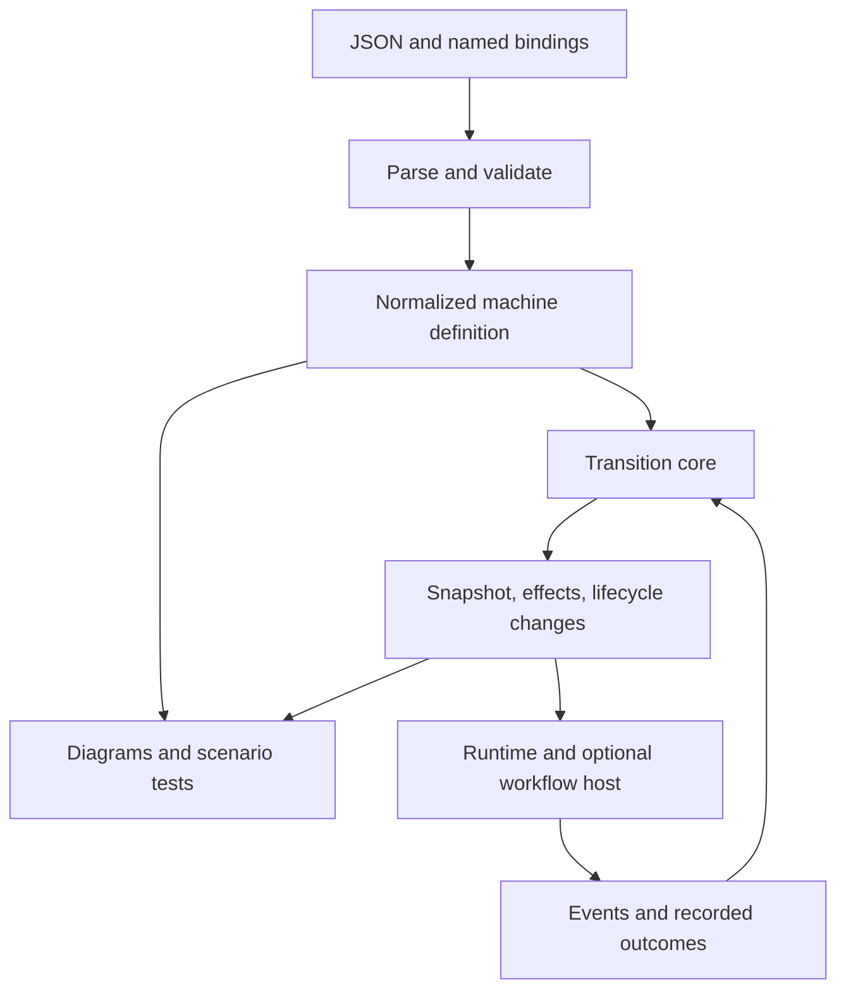

# Statechart and workflow direction

## Status and scope

- Status: **Draft implementation plan**, prepared November 12, 2026.
- Audited base: [d98f2227669770aa78566b32db2d88e318cb2392](https://github.com/JovaniPink/xstate-python/tree/d98f2227669770aa78566b32db2d88e318cb2392).
- Evidence owner: [dated source and execution evidence](statechart-workflow-evidence.md).
- Existing tracking: [#53](https://github.com/JovaniPink/xstate-python/issues/53),
  [#54](https://github.com/JovaniPink/xstate-python/issues/54),
  [#55](https://github.com/JovaniPink/xstate-python/issues/55),
  [#56](https://github.com/JovaniPink/xstate-python/issues/56), and
  [#57](https://github.com/JovaniPink/xstate-python/issues/57), all open when refreshed.
- Decision owner: the repository maintainer. Module ownership below identifies
  implementation locations, not assignments to people.

This PR records direction, evidence, proposed contracts, and reviewable work
packages. It does not implement the proposed behavior or close those issues.
Acceptance identifiers below belong to this plan; current runtime behavior
continues to be documented in the concept guides. Mark an acceptance item
implemented or verified only with links to its implementation and results.

## Objective and observable outcome

Develop a dependable, inspectable Python statechart and actor library for
application workflows, with an executable contract for a useful XState JSON
subset and an optional host for restartable human/AI workflows.

> Define the process, validate it before execution, observe why it moved, and
> integrate external work through explicit effects.

The next capability milestone is complete when literal shared JSON runs against
a pinned JavaScript reference and Python with the promised observable behavior,
unsupported models receive useful diagnostics, and one synthetic contribution
workflow demonstrates review, failure, retry, restart, and duplicate delivery.
A subsequent document-packet example should reuse those contracts.

This extends the existing [product thesis](../PRODUCT.md). It does not establish
full XState compatibility, full W3C conformance, arbitrary formal verification,
or exactly-once external execution. These require separate evidence.

## Current evidence and constraints

The baseline already has hierarchical/parallel/history states, actors, sync and
async runtimes, snapshot helpers, a two-pass parser, typed handlers, Mermaid
export, SimulatedClock, microstep/macrostep traces, and a local inspector.
The runtime declares no dependencies. Extend these facilities.

The audit recorded 618 primary tests passing with 92.29% aggregate coverage,
57 SCXML-suite tests passing, mypy passing across 23 source files, and Ruff lint
passing on Python 3.13.5. These are **baseline local results**, not results for
this planning PR's eventual head or the complete release matrix. The evidence
document records commands, tool versions, reproduction output, and limits.

Despite that baseline, direct comparisons with JavaScript XState 5.33.4 found:

| Evidence family | Observed difference | Planned owner |
|---|---|---|
| Numeric JSON delays | An after key of "1000" becomes an unregistered Python delay name | WP1 |
| Action arguments | Deferred effects see final context and the outer event rather than the context/event at their position | WP3 |
| Re-entry | Default/false reenter behavior differs; actual re-entry does not restart children or deadlines | WP4 |
| Final completion | A done snapshot can leave the actor running and processing later events | WP4 |
| Observable input | Ordinary positional factory input is not bound correctly | WP2 / #53 |
| Restored output | A computed final output can be lost during reconstruction | WP5 / #54 |
| Validation | Duplicate IDs and contradictory state shapes can pass construction | WP6 |

The observable and restoration cases already have issues. Output reconstruction,
mutable nested context, and the sync/async split have documented boundaries;
describe changes to those contracts explicitly rather than inventing prior
guarantees.

### Invariants

- Preserve `Machine(config, actions=..., guards=..., delays=..., actors=...)`
  and the data-oriented configuration boundary.
- Retain the SCXML-style run-to-completion core. Do not replace algorithm.py
  wholesale or implement a second simulator in tools.
- Keep the Python core dependency-free and JavaScript tooling confined to
  development/CI. No general JavaScript evaluator or Js2Py.
- Keep declaration order meaningful: transition priority, region order, actions,
  raised events, and lifecycle effects cannot be sorted for convenience.
- Keep handler signature adaptation out of the normal transition hot path.
- Preserve current public APIs while explicitly reviewing behavioral changes.
  Correctness fixes can still require migration notes.
- Preserve upstream notices; distinguish independent maintenance from official
  upstream ownership.

### Non-goals for this milestone

C++ generation, SysML/Cameo/Stateflow support, a general Mermaid importer, a plugin
marketplace, provider-specific agent orchestration, distributed scheduling,
hard-real-time guarantees, unrestricted symbolic proofs, a new visual editor,
and a package rename or publication are outside implementation scope here.
Optional adapters follow an executable example and demonstrated consumer need.

## What to adopt from fsmc and amy

| Source | Transferable pattern | Application here | Boundary |
|---|---|---|---|
| fsmc FsmIr | One normalized model shared by tools | Extend the existing parser/resolved nodes; separate definition from bindings and actor state | Do not copy its hardware/type metamodel or create a competing runtime representation |
| fsmc diagnostics | Stable codes, severity, locations, help; text/JSON/CI output | Validate configurations and report multiple actionable findings before startup | A structural warning is not a proof about arbitrary Python guards |
| fsmc analysis and recording | Explicit semantics, bounded exploration, counterexamples | Document the supported profile; replay event sequences with controlled time | No inherited universal verification, real-time, or zero-allocation claim |
| Amy decision/effect separation | Observe, decide, execute named effects, fold outcomes | Keep statechart decisions in the core; execute workflow effects through a host | Do not replace statechart semantics with a second polling-plan engine |
| Amy operational outcomes | Waiting differs from a real failed attempt; moves have reasons | Model review, missing evidence, throttling, retries, and receipts explicitly | Agent budgets and application retry policy remain outside the core |
| Amy dependency checks/testkit | Validate bindings; exercise simulated worlds | Add structured diagnostics and scenario helpers around current clocks/traces | Scenario coverage does not prove exhaustive reachability |

Sources: [fsmc FsmIr](https://github.com/simoneCavalleri/fsmc/blob/8d7ce8a71cc881d94ea6888e4ad700634514fd46/include/fsm/ir/fsm_ir.hpp),
[diagnostics](https://github.com/simoneCavalleri/fsmc/blob/8d7ce8a71cc881d94ea6888e4ad700634514fd46/include/fsm/diagnostic/diagnostic_engine.hpp),
[Amy plans](https://github.com/nicolasmelo1/amy/blob/3fee6a5ce1a6dedd1039e0cf4007659e7c0536e2/packages/core/src/work.ts), and
[testkit](https://github.com/nicolasmelo1/amy/blob/3fee6a5ce1a6dedd1039e0cf4007659e7c0536e2/packages/workflow-testkit/src/conformance.ts).

Amy's Mermaid grammar rejects composite states and concurrent regions, and its
worker logs an undrawn transition after saving the changed record. Retain the
statechart definition as the authority here; derive diagrams from it.
Amy's separate effect/store/queue operations also do not establish transactional
workflow durability. The evidence document explains both limits.

## Architecture and ownership

Keep three layers: the statechart library, developer tools, and an optional
workflow host. A host supplies operational guarantees; a chart supplies process
rules. Providers, databases, and agent SDKs do not enter the core dependency set.



The diagram describes intended ownership, not a claim that all proposed
interfaces exist. Pure evaluation assumes application guards and assignments
follow their documented contract; Python callables are not made pure by typing.

| Existing module | Responsibility to extend |
|---|---|
| [config_parser.py](../../src/xstate/config_parser.py), [schema.py](../../src/xstate/schema.py) | Normalize supported forms, resolve references, retain configuration paths, expose diagnostics |
| [state_node.py](../../src/xstate/state_node.py), [transition.py](../../src/xstate/transition.py) | Ordered resolved definitions; separate stable data from bindings and mutable execution state |
| [algorithm.py](../../src/xstate/algorithm.py) | RTC selection, assignment/internal-event order, per-action causal data, ordered exit/entry information |
| [machine.py](../../src/xstate/machine.py), [handlers.py](../../src/xstate/handlers.py) | Preserve public transition API and parse-time adaptation; bind effects to the correct arguments |
| [interpreter.py](../../src/xstate/interpreter.py), [async_interpreter.py](../../src/xstate/async_interpreter.py) | Queue ownership, actions, deadline lifecycle, completion, cancellation |
| [actor.py](../../src/xstate/actor.py) | Child generations, invocation, messaging, completion, callable input |
| [snapshot.py](../../src/xstate/snapshot.py), [state.py](../../src/xstate/state.py) | Output restoration, independent observations, envelope compatibility and migration |
| [scheduler.py](../../src/xstate/scheduler.py), [trace.py](../../src/xstate/trace.py) | Reuse virtual time and inspection; expose stable evidence without changing execution |
| [mermaid.py](../../src/xstate/mermaid.py), [local_inspector.py](../examples/local_inspector.py) | Consume the runtime's definition/traces; retain one execution authority |
| [docs/examples](../examples/README.md), [integration proposal](../integrations/adk-and-agent-skills.md) | Host and workflow demonstrations; optional adapters only after their contracts are proven |

### Proposed internal contracts

Start with private types and prove behavior before expanding the public API.

- A normalized definition has stable state identities, declaration-ordered
  transitions, source/configuration paths, named binding references, and an
  explicit supported-semantics description.
- Bindings connect those references to Python actions, guards, delays, and actor
  logic. Arbitrary callables are not portable declaration data.
- Actor-owned data includes context, active configuration, history, event queues,
  timers, invocation handles, and generations.
- A transition result carries the next snapshot, ordered effect descriptions,
  and sufficient ordered lifecycle information. A final active-state set alone
  cannot describe exit/re-entry.
- Each deferred effect captures its triggering event, parameters, and the
  context at its position using the context policy. Trace collection must not
  change that behavior.
- Diagnostics distinguish errors, warnings, and unknown/unsupported analysis.
  Stable codes and configuration paths precede source-file line/column support.

A future CLI such as `python -m xstate validate workflow.json --format json`
is a proposal, not an available command. Static JSON validation should not import
and execute arbitrary implementation modules; named-binding manifests can
establish reference availability without executing handlers.

### Compatibility and version identity

Document one v5 data-only subset before exposing multiple runtime profiles.
The initial reference is **xstate 5.33.4 on Node 24.22.1**; pin and lock it.
Do not treat arbitrary executable JavaScript configuration as portable JSON.

Version these separately:

1. The supported semantics/compatibility contract.
2. The machine definition and its implementation-binding version.
3. The persisted snapshot schema.

A definition fingerprint must preserve semantic ordering and cannot identify
the behavior of a Python callable by hashing its name or repr. Applications
must supply implementation identity where restore compatibility depends on it.

XState v6 entered beta on November 5, 2026; v5 remains supported. Track v6
evaluation independently and recheck its official docs before implementing an
adapter. Passing v5 fixtures provides no evidence of v6 support.
See the [announcement](https://stately.ai/blog/2026-11-05-xstate-v6-beta),
[v6 FAQ](https://stately.ai/docs/xstate/v6/faq), and the dated evidence snapshot.

## Delivery sequence and dependency gates

Each package includes behavior, documentation, and tests. Status is **proposed**
for every package. Implementations should be small, independently reviewable PRs
where their prerequisites allow that.

| Package | Observable outcome | Dependencies |
|---|---|---|
| WP1 | Literal JSON numeric delays run equivalently, with a pinned comparison harness | Baseline and D1/D2 |
| WP2 | Observable factories satisfy the advertised input contract | Baseline; can run alongside WP1 |
| WP3 | Deferred actions observe their own context/event/parameters | WP1 harness |
| WP4 | Re-entry and completion own the correct resource lifecycle | WP1; coordinate result contract with WP3 |
| WP5 | Final output survives supported snapshot round trips | Baseline; independent narrow #54 slice |
| WP6 | One normalized model supports structured validation | WP1/WP3/WP4 semantics reviewed |
| WP7 | Restore has a versioned, explicit compatibility contract | WP5 and WP6 definition identity |
| WP8 | Scenario and trace tools explain outcomes reproducibly | WP3/WP4; diagnostic vocabulary from WP6 |
| WP9 | Contribution workflow recovers across defined failure boundaries | WP1–WP8 outcomes needed by the scenario |
| WP10 | Document-packet example reuses the contribution host contracts | WP9 |
| WP11 | Independent distribution identity and release policy are decided | Research can run in parallel; release depends on required capability gates |

### WP1 — Literal JSON compatibility and numeric delays (#55)

**Outcome:** a checked-in JSON chart with `after: {"1000": "done"}` runs
correctly in Python and the pinned JS runtime. The comparison runner becomes
the foundation for later fixtures, not a Node dependency of the Python package.

Extend `StateNodeConfigParser._build_after` and the shared delay resolution
boundary as appropriate. Keep timer-key normalization distinct from other APIs
that may intentionally accept a named delay. Add a proposed development-only
directory such as `tests/compatibility/xstate_v5/` with fixture JSON, equivalent
named implementation registries, event/time sequences, exact expected results,
a JS runner, and a lockfile. Wire a documented command into the existing CI.

| Acceptance | Observable behavior and evidence |
|---|---|
| COMP-01 | The same literal JSON is loaded by both runtimes; a 1,000 ms delay stays pending at 999 and fires at 1,000 |
| COMP-02 | Compare value, context, status, output, action-visible arguments/order, child lifecycle, and logical time after every command |
| COMP-03 | Numeric-looking delay/registry collision, descriptive named delay, invalid delay, and supported numeric forms have explicit results |
| COMP-04 | A mismatch reports fixture, command index, differing field, expected/actual values, and exact runtime versions |
| COMP-05 | Known divergences are listed explicitly with expected observations; unexpected pass/failure is surfaced, and corrected cases become mandatory passes |
| COMP-06 | Core imports and built artifacts require no Node or npm packages |

Normalize representation differences only through documented adapters. Do not
drop inconvenient events, actions, or lifecycle fields to produce agreement.
Keep independently asserted expected outcomes so two runtimes agreeing on a
broken fixture is insufficient.

Tests extend [test_after.py](../../tests/test_after.py). The numeric-name
precedence decision is D2. Do not claim additional numeric-string grammar
without a reference case.

### WP2 — Observable input binding (#53)

**Outcome:** the public unary factory contract works regardless of an ordinary
parameter's name. Extend `_ObservableBackend.start` and reuse the safe signature
binding approach already established for promise factories.

| Acceptance | Observable behavior and evidence |
|---|---|
| OBS-01 | Positional and positional-only factories receive actor input |
| OBS-02 | Named-input, keyword-only, zero-argument, and direct async-iterable forms retain documented behavior |
| OBS-03 | Invoke a factory once; preserve a factory's original exception rather than retrying calls on TypeError |
| OBS-04 | Runtime emissions and static generic inference agree; optional/variadic signature behavior is documented |

Extend [test_async_actors.py](../../tests/test_async_actors.py), the pattern in
[test_promise_callable_contract.py](../../tests/test_promise_callable_contract.py),
and [positive typing fixtures](../../tests/typing/positive.py).
This package does not redesign the actor runtime or async machine actions.

### WP3 — Causal action arguments

**Outcome:** each deferred action observes the context/event/parameters at its
position. Preserve the pure evaluation/effect-execution boundary.

Extend `execute_content`, `MacrostepResult`, `AlgorithmMicrostep`, and
`Machine._get_actions/_bind_action` with the smallest internal contract needed.
Do not execute external effects inside algorithm.py to repair argument binding.

| Acceptance | Observable behavior and evidence |
|---|---|
| EFFECT-01 | record → assign(n=1) → record → raise(INNER) → record observes (0, GO), (1, GO), (1, INNER) |
| EFFECT-02 | Entry, exit, transition, higher-order, eventless, and parallel effects preserve declared order and their own arguments |
| EFFECT-03 | Sync and async effect consumers use equivalent causal arguments; async actions retain documented await order |
| EFFECT-04 | Trace-enabled and trace-disabled runs agree; context capture honors ContextAdapter and avoids mutable aliasing |
| EFFECT-05 | Exceptions retain the documented commit-before-effects behavior; migration notes describe any observable argument change |

Extend [test_action_ordering.py](../../tests/test_action_ordering.py),
[test_microstep_traces.py](../../tests/test_microstep_traces.py),
[test_choose_pure.py](../../tests/test_choose_pure.py),
[test_raise_send_cancel.py](../../tests/test_raise_send_cancel.py), and async
action cases. Inspect existing copy-budget assertions; measure overhead if the
implementation adds context copies, without claiming performance gains.

### WP4 — Re-entry, timers, children, and completion

**Outcome:** lifecycle behavior reflects actual transitions, including multiple
microsteps in one macrostep. Coordinate the result representation with WP3.

Extend `TransitionConfig`, transition normalization, algorithm entry/exit
calculation, both interpreters' `_sync_delays`, and
`Actor._reconcile_invocations_once`. Preserve internal-event priority and
run-to-completion. Do not start invocation work for transient states when the
reference semantics defer invocation until the chart settles.

| Acceptance | Observable behavior and evidence |
|---|---|
| LIFE-01 | Omitted/false/true reenter and explicit legacy internal/external forms have documented, paired behavior |
| LIFE-02 | A true re-entry stops the previous invoked child once and starts a new generation once |
| LIFE-03 | Reset at 500 ms renews a 1,000 ms state-owned deadline; state exit cancels old timers/delayed work according to its ownership |
| LIFE-04 | Late results from a previous invocation generation cannot mutate a replacement invocation's workflow |
| LIFE-05 | Top-level final completion cleans up owned resources and ignores later sends; nested final states complete only their owning scope |
| LIFE-06 | Startup directly into final, nested/parallel/history transitions, internal events, and re-entrant sends retain correct order |
| LIFE-07 | Sync, asyncio, and actor boundaries have explicit supported behavior; cancellation and failure do not silently drop queued callers |

Extend [test_invoke.py](../../tests/test_invoke.py),
[test_after.py](../../tests/test_after.py),
[test_actor.py](../../tests/test_actor.py),
[test_async_interpreter.py](../../tests/test_async_interpreter.py),
[test_history_extended.py](../../tests/test_history_extended.py),
[test_parallel.py](../../tests/test_parallel.py), and
[test_startup_queueing.py](../../tests/test_startup_queueing.py).
Run the primary and SCXML suites for algorithm, timer, or queue changes.

Do not silently make AsyncInterpreter an actor runtime. Its present boundary
and machine actors' synchronous action execution are documented; D4 controls
any later unification. D3 controls the migration from legacy transition behavior.

### WP5 — Preserve completed output (#54, first slice)

**Outcome:** supported round trips retain completed output without re-running
its computation. Extend `deserialize_snapshot` and State's output construction
with an explicit absent-field sentinel where needed.

| Acceptance | Observable behavior and evidence |
|---|---|
| SNAP-01 | Computed and literal output survives serialization, JSON encoding, restore, and actor resume |
| SNAP-02 | Absent legacy output and explicit JSON null are distinct inputs with documented behavior |
| SNAP-03 | Active snapshots, error representations, and current-version payloads retain supported behavior |
| SNAP-04 | Restoring recorded output does not invoke a callable with a missing or fabricated historical event |

Extend [test_snapshot.py](../../tests/test_snapshot.py) and relevant
[test_v5_config.py](../../tests/test_v5_config.py) cases. Update the persistence
guide's reconstruction contract. Keep broad schema migration and deep context
ownership out of this narrow fix; they belong to WP7.

### WP6 — Normalized definition and structured diagnostics

**Outcome:** execution and tooling consume the same resolved semantics and
invalid charts fail with actionable diagnostics.

Build on the existing parser, StateNode, and Transition. Progressively separate
raw declaration data, normalized definitions, bindings, and actor state.
Do not add a public compiler/plugin abstraction before this separation is useful.

| Acceptance | Observable behavior and evidence |
|---|---|
| VALID-01 | Duplicate IDs, invalid initial/target references, contradictory state shapes, missing bindings, invalid delays, and unsupported executable properties have stable error codes and config paths |
| VALID-02 | Multiple independent findings can be collected without constructing an actor or running guards/actions/services |
| VALID-03 | Text and JSON diagnostics agree; CI annotations use the same findings when file locations are available |
| VALID-04 | Validation shares target-resolution and normalization rules with execution and preserves source declaration order |
| VALID-05 | Passive metadata/extensions have an explicit policy; opt-in stricter validation does not indiscriminately reject previously valid Machine configs |
| VALID-06 | Structural warnings and bounded results report assumptions; opaque Python predicates yield unknown where proof is unavailable |
| VALID-07 | Two actors can share a definition without sharing context, history, handles, timers, or mutable execution data |

Update [machines and implementations](../concepts/machines-and-implementations.md).
The definition freeze must account for backreferences, caches, and callable
registries; frozen outer containers alone do not guarantee deep immutability.
A CLI imports only explicit trusted application bindings when executing a
scenario, never as an implicit part of static JSON validation.

### WP7 — Versioned restoration and observation ownership

**Outcome:** stored state identifies what can safely restore it and failures are
explicit. Design the envelope before exposing a new serialization API.

| Acceptance | Observable behavior and evidence |
|---|---|
| RESTORE-01 | Encode snapshot schema, machine identity/version, implementation identity, and semantics contract separately |
| RESTORE-02 | Known legacy payloads have a supported reader/migration path; unknown states/history IDs or incompatible identities are rejected clearly |
| RESTORE-03 | Error data, computed output, and context codecs have tested JSON-compatible contracts |
| RESTORE-04 | Document live mutable context versus detached observations; add a deliberate detached/read-only projection if needed without silently breaking dictionary consumers |
| RESTORE-05 | Specify deadline, queue, child, and effect restoration limits; a snapshot alone never claims process recovery |
| RESTORE-06 | Migrations are deterministic, tested against representative checkpoints, and refuse unsupported downgrade/definition combinations |

Extend snapshot.py, state.py, and the existing persistence guide/tests.
Start by recording required metadata in the example host if a stable public
envelope needs more experience. That is an explicit example contract, not an
undocumented promise that arbitrary actors have durable persistence.

### WP8 — Scenario testing and inspectable outcomes

**Outcome:** developers can reproduce a failing run and understand the evidence
without a second execution engine.

Extend current SimulatedClock, traces, Mermaid rendering, and inspector hooks.
Create scenario helpers only after the compatibility fixture vocabulary settles.

| Acceptance | Observable behavior and evidence |
|---|---|
| TRACE-01 | Preserve macrostep/microstep/transition order, repeated/ignored events, and sequence identity |
| TRACE-02 | Distinguish observed state, selected transition, effect intent, effect start, and completed/failed effect; inspection is not a tool receipt |
| TRACE-03 | Virtual-time scenarios assert waits, actual attempts, retry ceilings, cancellation, final outcomes, and invocation generations |
| TRACE-04 | Coverage reports distinguish unvisited states/edges from proven structural unreachability |
| TRACE-05 | Replay modes distinguish pure decision replay, replay with recorded outcomes, and deliberate effect re-execution |
| TRACE-06 | Capture selected fields with a configurable projection/redaction policy; do not automatically retain document bodies or model prompts |

An optional OpenTelemetry adapter may consume this contract later. It must not
become a core dependency or change execution when an observer fails. Do not
re-evaluate a guard solely to display its result; record the actual evaluation
if that information is made available.

### WP9 — Restartable contribution workflow (#56)

**Outcome:** one synthetic workflow progresses through implementation,
validation, review, ready-to-merge, and merged, with inspectable recovery.

Use shared JSON, named implementations, and a fake GitHub adapter. The host
authenticates event provenance, supplies accepted events, persists state, and
dispatches effects. The chart owns process eligibility. Keep network/model
providers optional and do not perform real repository writes in the demo.

| Acceptance | Observable behavior and evidence |
|---|---|
| FLOW-01 | Review and CI evidence refer to the current head SHA; a new revision invalidates old evidence |
| FLOW-02 | The host commits accepted-event identity, snapshot revision, and effect intent in one real storage transaction |
| FLOW-03 | Revision/CAS checks reject stale writers; duplicate input does not create a second intent |
| FLOW-04 | Effect IDs remain stable across retries/restarts; pending effects are recoverable |
| FLOW-05 | A merge intent binds the expected head SHA and requires authoritative approval evidence |
| FLOW-06 | A merge succeeding before its response is lost is reconciled with provider state before retrying |
| FLOW-07 | A reader can inspect events, transitions, intent/result records, and the reason work is waiting or blocked |
| FLOW-08 | Intent eligibility carries its authorized revision/generation; superseded or canceled undispatched work is suppressed, and late external results are recorded without advancing the current workflow |

A standard-library SQLite host is the recommended first implementation.
Commit the durable inbox/snapshot/outbox transaction before dispatching an
external effect. Executing an effect and recording its result remain a separate
failure window: use idempotency or query/reconciliation, not an exactly-once
claim. Persist ownership/revision information sufficient to reject stale workers.

Serialize an intent's eligibility/claim with revision changes and recheck its
authorization before dispatch. A claim cannot atomically control an external
provider: use provider preconditions such as expected-head matching where
available. If eligibility changes after dispatch, retain the external result as
a fact and reconcile it; do not let a stale success approve or advance a newer
revision. Idempotency prevents duplicate execution, not stale authorization.

Crash tests cover before transaction commit, after commit/before dispatch,
after provider success/before result persistence, duplicate result delivery, and
restart with stale review evidence. Also commit an intent at revision N, accept
revision N+1 that invalidates it, then attempt dispatch or deliver its late
result. These cases must show either a recovered outcome or an explicit
unresolved-effect state.

### WP10 — Synthetic document-packet workflow

**Outcome:** the same host contracts support a domain example without putting
domain rules in the library.

Model extraction, missing evidence, human review, revision-bound approval,
submission pending, and a confirmed receipt. Use fabricated documents/IDs and a
fake submission provider; the example makes no crop-insurance compliance claim.

| Acceptance | Observable behavior and evidence |
|---|---|
| DOC-01 | Waiting for missing information or review does not consume a processing-failure attempt |
| DOC-02 | Transient failure and quota/capacity rejection have distinct retry accounting and timing |
| DOC-03 | Approval identifies one document revision; a subsequent revision invalidates it |
| DOC-04 | Submission reaches confirmed state only from an authoritative adapter receipt |
| DOC-05 | Duplicate events, restart, ambiguous submission, and revision changes before dispatch or before a late receipt use WP9 recovery contracts |
| DOC-06 | A second consumer can run the example through documented APIs without modifying core modules |

An LLM may propose structured events or extracted data. Its prose is not an
approval, authenticated event source, or provider receipt.

### WP11 — Independent identity and packaging (#57)

**Outcome:** the project has a clear ownership, installation, and compatibility
story. "Measured Statecharts" and `measured-statecharts` are working candidates,
not selected, available, reserved, or published names.

| Acceptance | Observable behavior and evidence |
|---|---|
| DIST-01 | Verify control of the selected distribution name before enabling publication |
| DIST-02 | Decide repository name, distribution name, import namespace, and compatibility contract separately |
| DIST-03 | Test install/migration and prevent collisions between distributions providing the same xstate package files |
| DIST-04 | Retain upstream license/authorship notices and provenance for any adopted code |
| DIST-05 | Publish release notes, supported-profile evidence, migration examples, and exact build/preflight receipts for a release candidate |

A namespace migration is a separate reviewed change. A renamed distribution
does not by itself remove import-file collisions. New feature names and branding
must describe implemented capability rather than imply upstream endorsement.

## Decisions and review triggers

These recommendations are not ratified merely because this planning PR exists.

| Decision | Proposed choice and alternatives | Evidence/review trigger | Blocks |
|---|---|---|---|
| D1 — Compatibility target | Start with an explicit v5 data-only subset and exact 5.33.4 oracle; evaluate v6 separately | Recheck pinned fixtures when reference version or supported surface changes | WP1 contract |
| D2 — Numeric delay precedence | For after keys, follow the pinned v5 numeric interpretation; retain descriptive names and document migration for numeric-looking registry names | Include a collision fixture with after "1000" and delays["1000"]=2000; inspect send-delay behavior separately | WP1 delay fix |
| D3 — Legacy re-entry behavior | Normalize explicit legacy type and canonical reenter deliberately; reject contradictory declarations rather than silently guess | Paired fixtures, SCXML importer behavior, migration examples; maintainer review before behavioral release | WP4 rollout |
| D4 — Async ownership | Preserve the documented split for this milestone; choose a unified async actor design only as a separate scope | Demonstration of a required workflow that cannot use the supported boundary | Future runtime unification |
| D5 — Definition and snapshot identity | Separate schema, machine/bindings, and compatibility versions; legacy reader/migration path | Representative persisted payloads and changed-definition cases | WP7/WP9 |
| D6 — Durable host | SQLite example with transaction, revision checks, and explicit idempotency/reconciliation | Crash-boundary tests and second consumer needs before generalizing | WP9 |
| D7 — Independent name | Candidate branding only until availability, ownership, namespace, and migration are verified | #57 evidence and release-readiness review | Publication/rename |
| D8 — Supported analysis | Structural diagnostics and bounded scenarios first; unknown for opaque predicates | Any proposal to advertise proof, automatic transformation, or new grammar | Analysis claims |

Resolve decisions at their owning package rather than requiring every later
decision before the first fix. Stop only the affected work when new evidence
invalidates an assumption; continue independent packages.

## Validation, rollout, and rollback

### Planning PR acceptance

- PLAN-01: all additions are documentation, with proposed APIs clearly labeled.
- PLAN-02: local relative links and acceptance/dependency references resolve.
- PLAN-03: evidence is dated and pinned; executed results, code inspection,
  limitations, proposals, and unexecuted gates are distinguishable.
- PLAN-04: existing issue links use "Related" semantics; no automatic closing of
  implementation issues from this documentation PR.
- PLAN-05: no credentials, private operational examples, local machine paths,
  or adopted third-party source are included inadvertently.

For a documentation-only PR, validate its diff, Markdown/link structure, and
evidence consistency. Do not rerun the broad runtime suite solely to relabel
earlier baseline evidence as a new result. Report hosted CI separately if it runs.

### Future implementation gates

Use current repository commands and CI at implementation time:

```bash
poetry run python -m pytest tests/ --ignore=tests/test_scxml.py
poetry run python -m pytest tests/test_scxml.py
poetry run mypy src/xstate/
poetry run ruff format --check src/ tests/ scripts/ docs/examples/
poetry run ruff check src/ tests/ scripts/ docs/examples/
poetry check --lock
poetry build
poetry run python scripts/validate_distribution.py
```

Run relevant narrow regressions first, then the required primary/SCXML gates
when algorithm, transition selection, queueing, timers, history, or eventless
behavior changes. Preserve the coverage floor and supported Python CI matrix.
The JS compatibility gate and host crash tests are proposed additions, not
commands already available in this baseline. Before release, run the existing
release preflight on the exact target and record hosted results for that SHA.

### Rollout and rollback

Land behaviorally complete packages with guide updates and migration examples.
Keep known compatibility gaps visible until fixed. Do not declare a v5 profile
supported if its required fixtures still diverge.

The planning PR can be reverted by removing its two plan documents and index
links. Runtime fixes require ordinary code rollback plus a documented semantic
migration; replaying events under an older version can produce different effects.

For new snapshot envelopes or host storage, define schema migrations and
downgrade limits before writing production data. Preserve original checkpoints
for migration/recovery and test rollback or explicitly reject unsupported
downgrades. Reverting a release cannot undo an external effect that already
occurred; recovery uses recorded identities and provider reconciliation.

### Checkpoints and success measures

- Compatibility: every advertised fixture passes; known gaps are explicit.
- Diagnostics: invalid supported-profile inputs produce reproducible findings.
- Lifecycle: cancellation, re-entry, finalization, and late-result behavior have
  direct evidence across the promised runtime boundary.
- Recovery: each specified crash boundary either completes safely or exposes an
  unresolved effect with enough information to reconcile.
- Adoption: a second Python consumer uses documented APIs without core edits.
- Maintenance: runtime dependencies stay empty; tests measure behavioral risk
  rather than raw test-count growth.

Review the exact implementation head at each package boundary. Revisit this
plan when the baseline, supported profile, snapshot contract, binding ownership,
or release identity changes. Stop the affected implementation for unexpected
concurrent edits, conflicting semantics, unavailable required gates, unsupported
migration, or a design that would move external effects into pure evaluation.
Do not bundle unrelated framework integration, publication, or a rewrite into a
compatibility repair.

## Source and document lifecycle

The [evidence document](statechart-workflow-evidence.md) is a dated observation,
not an automatically current status page. This plan owns proposed acceptance
criteria. Current concept guides own implemented user contracts. Implementation
PRs should update the relevant guide, link their acceptance evidence here, and
leave historical findings clearly dated rather than rewriting them as though
they had never occurred.

Refresh [product notes](../PRODUCT.md), [runtime choices](../concepts/runtimes.md),
[persistence](../concepts/persistence.md), [typing](../concepts/typing.md),
[machines and implementations](../concepts/machines-and-implementations.md), and
the [example index](../examples/README.md) as their corresponding packages land.
Do not copy the entire roadmap into AGENTS.md or establish a second issue tracker.
